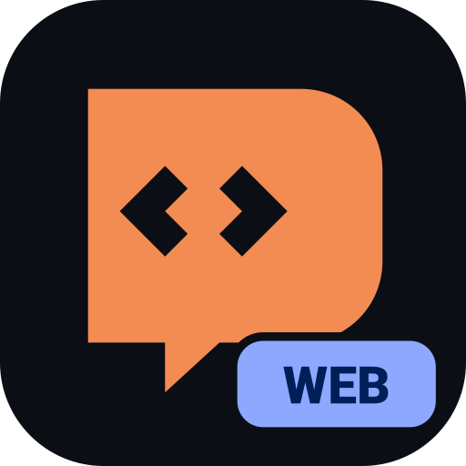

<div align="center">

  

  # Mobile Harness Web

  ### *The complete autonomous AI development workspace ported to Web & PWA.*

  **Chat with coding agents, edit projects, execute real Python and Linux commands, and preview live web servers — directly in your browser.**

  <br />

  [](https://payalktr80-web.github.io/Mobile-Harness-Web/)
  [](#progressive-web-app)
  [](#python-subsystem)

</div>

<br />

---

## Overview

**Mobile Harness Web** is a complete, faithful port of [Mobile-Harness](https://github.com/techjarves/Mobile-Harness) into a modern Web application and Progressive Web App (PWA).

It preserves the exact Jetpack Compose Material 3 dark/light design, brand palette (`#F28C52`, `#8EA8FF`, `#69D69E`, `#0B0E14`), navigation structure, and autonomous coding workflow:

- 🚀 **Projects Workspace**: Manage multiple projects, create instant Quick Projects, or import existing ZIPs & Git repositories.
- 🤖 **Claude Code Replicate**: Autonomous coding agent that uses your own API keys (Anthropic, OpenRouter, DeepSeek, Moonshot Kimi, or Custom) with multi-turn tool calling, thinking trace accordions, and automated diffs.
- 🐍 **Real Python 3.12 WebAssembly Subsystem**: Run Python scripts in the browser via Pyodide, with real `pip install` wheel package installation via `micropip`.
- 💻 **WebContainer & Virtual Terminal**: An interactive Linux userspace console with hardware helper keys (UP, DOWN, CTRL, ALT, ESC, TAB), prompt `root@pocket:$promptPath# `, and quick command chips (`uname -a`, `ls -la`, `pwd`, `python3`, `pip list`, `claude --version`).
- 🔄 **Git Changes & Diff Viewer**: Track modified files line-by-line with unified diffs (+green, -red), and Keep/Undo controls powered by `isomorphic-git`.
- 🌐 **Instant Live Web Preview**: Real-time sandboxed preview with responsive mobile & desktop frame switchers and live reload.
- 📱 **Progressive Web App (PWA)**: Installable directly on Android, iOS, Windows, macOS, and ChromeOS with offline caching.

---

## Capabilities

| Feature | Description |
| :--- | :--- |
| **Autonomous Agent** | Powered by Claude Code replicate. Reads files, drafts code, executes Python, runs bash commands, and creates diffs. |
| **Python & Pip** | In-browser WebAssembly Python 3.12. Execute `.py` files and install packages (e.g. `numpy`, `sympy`, `requests`, `pandas`) with `pip install`. |
| **Terminal Engine** | Powered by `@webcontainer/api` and custom shell with history, input streaming, and command execution. |
| **Code Editor** | Integrated code editor with line numbers, syntax icons, save, and instant Python runner. |
| **Git Version Control** | `git status`, `git commit`, `git log`, `git add`, and diff computation. |

---

## Quickstart

### 1. Install & Run Locally

```bash
# Clone the repository
git clone https://github.com/payalktr80-web/Mobile-Harness-Web.git
cd Mobile-Harness-Web

# Install dependencies
npm install

# Start development server
npm run dev
```

### 2. Configure AI Provider
1. Open **Settings → AI Model Provider**.
2. Select your provider (**Anthropic API**, **OpenRouter**, **DeepSeek**, **Kimi**, or **Custom**).
3. Enter your API key and tap **Validate Connection**.

### 3. Build Your First Project
1. Tap **Quick Project** on the Projects screen.
2. In the **Chat** tab, ask Claude Code to build a script or web application.
3. Watch the agent inspect files, write code, run python tests, and launch live web previews!

---

## License

MIT License. Ported from [techjarves/Mobile-Harness](https://github.com/techjarves/Mobile-Harness).
